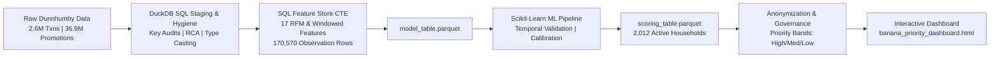

# Retail Customer Replenishment & Targeted CRM Engine
### End-to-End Predictive Analytics, Feature Store, and Interactive Marketing Dashboard
[](https://duckdb.org/)
[](https://python.org)
[](https://scikit-learn.org/)
[](https://opensource.org/licenses/MIT)

---

## 1. Executive Summary

In mass retail, blasting generic promotional campaigns to entire customer bases erodes profit margins and creates marketing fatigue. This project builds a production-grade, end-to-end **Customer Replenishment Prediction & Targeted CRM System** on the complete **Dunnhumby "The Complete Journey"** dataset.

By combining an enterprise **SQL Feature Store (DuckDB)** with a **Machine Learning Pipeline (Scikit-Learn)** and an **Interactive Executive UI (HTML5/CSS3/ES6)**, this system forecasts whether an active household will replenish grocery staples (anchored on fresh produce: Product `1082185`) within the next 28 days.

### Key Business & Technical Outcomes
* **2.72x Lift Over Random Outreach:** Targeting the top score decile captures buyers at a **92.7% hit rate**, compared to a 34.1% baseline.
* **80% Cost Reduction:** Reaching the top 20% of households (Deciles 1 & 2) captures over **60% of all incremental buyers**, eliminating 80% of communication and discount waste.
* **Large-Scale Data Engineering:** Ingested and audited **2,595,732 raw transactions** and **36,923,959 promotional records** with sub-second analytical execution in DuckDB.
* **Zero Data Leakage:** Implemented strict temporal cutoff validation with a 28-day gap buffer to mirror real-world inference.
* **Data Privacy Governance:** Enforces pseudo-anonymization (`HH-xxxx` tokens) separating customer PII from marketing dashboard outputs.

---

## 2. System Architecture



---

## 3. Dataset & Data Engineering Profiling

The project processes the complete Dunnhumby dataset covering 2,500 households over 102 weeks (711 days):

| Entity | Raw Rows | Storage | Description |
| :--- | :--- | :--- | :--- |
| `transaction_data.csv` | 2,595,732 | ~141 MB | Basket-level transactions, spend, quantity, discounts |
| `causal_data.csv` | 36,923,959 | ~695 MB | Weekly store-level mailer & physical display placements |
| `product.csv` | 92,353 | ~6.4 MB | Commodity hierarchy, department, brand classification |
| `hh_demographic.csv` | 801 | ~44 KB | Household size, income, age brackets, homeowner flags |

### Key Engineering Audits in `dunnhumby_queries.sql`
1. **Promotional Duplication RCA:** Investigated apparent primary key duplicates in `causal_data` (`store_id`, `product_id`, `week_no`). Proved that 99.3% of duplicate instances represent physical multi-location placements within the same store (e.g., end-cap display + middle aisle shelf).
2. **Pricing Integrity Formula:** Reconstructed shelf pricing from split discounts:
   $$\text{Shelf Price} = \text{sales\_value} - (\text{retail\_disc} + \text{coupon\_disc} + \text{coupon\_match\_disc})$$
3. **Transaction Hygiene:** Audited zero-quantity vs. zero-dollar transactions, isolating Buy-One-Get-One (BOGO) promotions from customer returns (`quantity <= 0`).

---

## 4. Feature Store & Observation Design

The feature pipeline calculates temporal features across multi-week rolling windows (4 weeks, 8 weeks, 12 weeks, and tenure):

* **Recency:** `days_since_last_purchase`, `days_since_last_banana`.
* **Frequency:** `baskets_4w`, `baskets_8w`, `banana_days_4w`, `banana_days_8w`, `banana_days_12w`, `banana_days_before`.
* **Monetary & Spend Dynamics:** `spend_4w`, `spend_8w`, `avg_basket_value_8w`, `spend_trend` ($\frac{\text{spend\_4w}}{\text{spend\_8w} / 2}$).
* **Customer Loyalty:** `tenure_days` (lifetime days observed).
* **Target Label (`banana_next_28d`):** Binary indicator ($y \in \{0, 1\}$) whether the household purchased in $[T + 1, T + 28]$.

The resulting dataset contains **170,570 observations** with an overall positive class prevalence of **34.1%**.

---

## 5. Machine Learning Benchmarks & Validation

To prevent temporal data leakage, data was split chronologically with a 28-day gap buffer:
* **Train:** Reference days $\le 426$ (60% split, 102,342 observations).
* **Validation:** Reference days $455 \text{ to } 568$ (20% split, 34,114 observations).
* **Test:** Reference days $> 596$ (20% split, 34,114 observations).

### Benchmark Comparison (Test Set)

| Model / Strategy | PR-AUC | ROC-AUC | Precision @ Top 10% | Lift @ Top 10% | Recall @ Top 10% |
| :--- | :---: | :---: | :---: | :---: | :---: |
| **Random Baseline (Dummy)** | 0.3381 | 0.5000 | 33.8% | 1.00x | 9.8% |
| **Heuristic: Bought in Previous 28 Days** | 0.5341 | 0.7323 | 61.6% | 1.82x | 18.2% |
| **Heuristic: Recency Rank** | 0.6476 | 0.8080 | 74.4% | 2.20x | 22.0% |
| **Histogram Gradient Boosting (HGB)** | 0.7633 | 0.8424 | 91.2% | 2.70x | 27.0% |
| **Calibrated Logistic Regression (Production)** | **0.7671** | **0.8444** | **92.0%** | **2.72x** | **27.2%** |

*The Calibrated Logistic Regression model was selected for production due to superior PR-AUC (0.7671), interpretability for marketing executives, and numerical stability across time folds.*

### Feature Importance & Coefficients

```
Feature                    Log-Odds Impact (Coeff)
--------------------------------------------------
banana_days_before         +0.7046  ====================
banana_days_12w            +0.5498  ===============
banana_days_4w             +0.3086  ========
banana_days_8w             +0.2802  =======
baskets_4w                 +0.2131  =====
spend_8w                   +0.1316  ====
avg_basket_value_8w        +0.1159  ===
days_since_last_banana     +0.0423  =
spend_4w                   -0.0044  
spend_trend                -0.0162  
days_since_last_purchase   -0.1451  ====-
baskets_8w                 -0.1578  =====-
tenure_days                -0.2092  ======-
```

---

## 6. Decile Performance & Business Lift

Validating the score deciles on unseen testing data reveals near-perfect monotonic calibration:

```
Decile    Predicted Volume    Actual Hit Rate (%)    Cumulative Conversion
-------------------------------------------------------------------------
Decile 1        201                 92.7%                  92.7%
Decile 2        201                 71.1%                  81.9%
Decile 3        201                 54.0%                  72.6%
Decile 4        201                 38.1%                  64.0%
Decile 5        202                 29.1%                  57.0%
Decile 6        201                 19.4%                  50.7%
Decile 7        201                 14.2%                  45.5%
Decile 8        201                 10.2%                  41.1%
Decile 9        201                  8.1%                  37.4%
Decile 10       202                  4.6%                  34.1%
```

### Business Interpretation
* **Top Decile (Decile 1):** Over **9 out of 10** targeted households replenish within 28 days.
* **Top Quintile (Deciles 1 & 2):** Captures **81.9% average conversion**, delivering the highest ROI for personalized coupon distribution.
* **Bottom Decile (Decile 10):** Converts at only **4.6%**, proving that marketing resources should not be deployed to this segment.

---

## 7. Interactive CRM Dashboard (`banana_priority_dashboard.html`)

An enterprise-ready, zero-dependency executive interface designed for non-technical commercial teams:
* **Real-Time Household Lookup:** Search any customer token (e.g., `HH-0412`) to inspect predicted probability, decile, and purchase cadence.
* **Dynamic Segmentation:** Filter active households across 4 operational priority tiers:
  * `Very high` (Decile 1)
  * `High` (Deciles 2–3)
  * `Medium` (Deciles 4–6)
  * `Low` (Deciles 7–10)
* **Dark / Light Theme:** Modern typography and responsive layout built with pure HTML5, CSS custom properties, and vanilla ES6 JavaScript.

---

## 8. Repository Structure

```
.
├── Dunnhumby data.ipynb             # Exploratory analysis, ML training, validation & lift curves
├── dunnhumby_queries.sql            # 2,000+ lines of enterprise DuckDB data engineering & feature store
├── banana_priority_dashboard.html   # Standalone interactive executive dashboard
├── banana_follow_up_list.csv        # Prioritized CRM activation list with household scores
├── dashboard_list.csv               # Dashboard feed with anonymized display IDs
├── decile_summary.csv               # Decile conversion hit rates for commercial planning
├── feature_coefficients.csv         # Model weights & log-odds feature contributions
├── model_comparison.csv             # Benchmark matrix across baseline, heuristics, and ML models
├── scoring_table.parquet            # 2,012 active households at cutoff day 711
├── requirements.txt                 # Reproducible environment dependencies
├── .gitignore                       # Safeguard against raw data & credential leaks
└── README.md                        # Project documentation
```

---

## 9. How to Run Locally

### 1. Clone the repository
```bash
git clone https://github.com/MohamedAbdo-0/Retail-Customer-Replenishment-Targeted-CRM-Engine.git
cd retail-replenishment-ml
```

### 2. Install dependencies
```bash
pip install -r requirements.txt
```

### 3. Open the Interactive Dashboard
Double-click `banana_priority_dashboard.html` or open it with any web browser (Chrome, Edge, Firefox, Safari).

### 4. Execute the Jupyter Notebook
```bash
jupyter notebook "Dunnhumby data.ipynb"
```

---

## 10. Author & Contact
* **Project:** Retail Customer Replenishment & Targeted CRM Engine
* **Dataset:** Dunnhumby "The Complete Journey"
* **Focus Areas:** Advanced SQL, Feature Stores, Calibrated ML, Retail Analytics, Data Privacy & CRM Deployment
